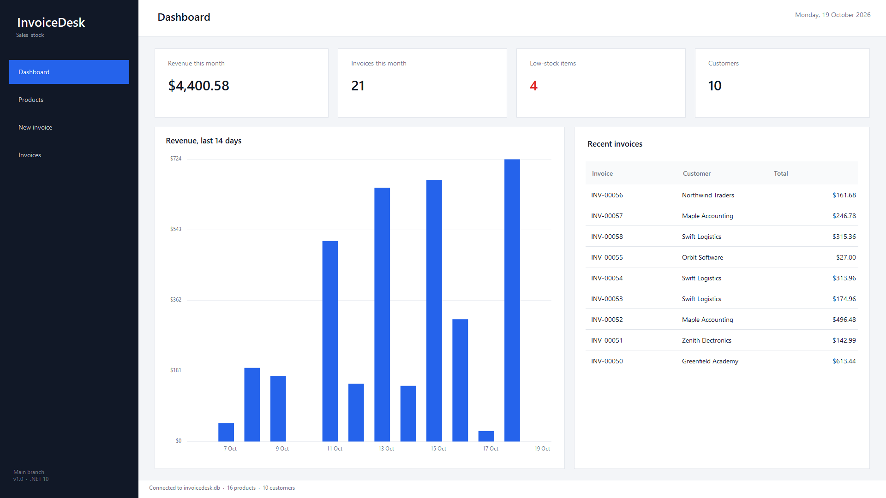
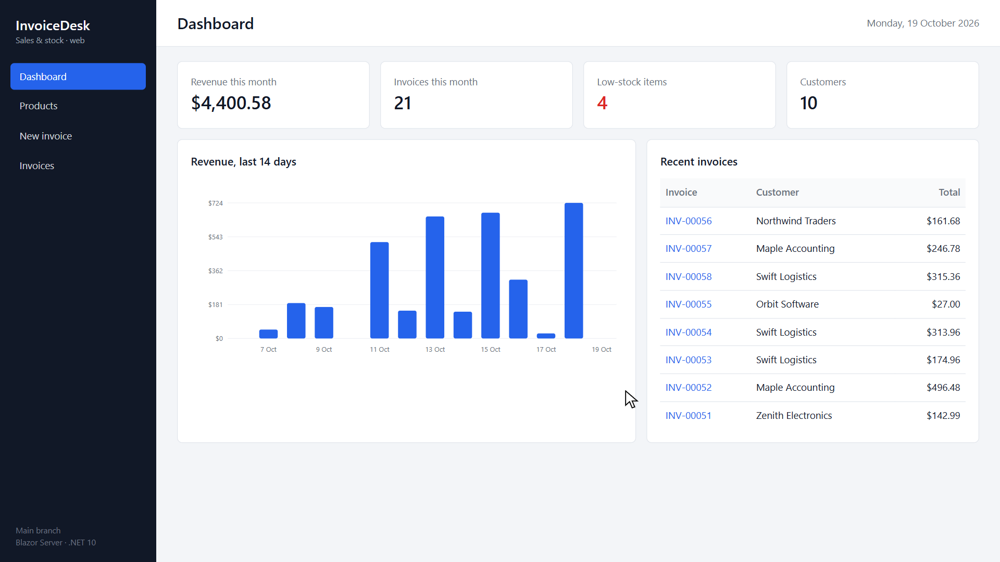
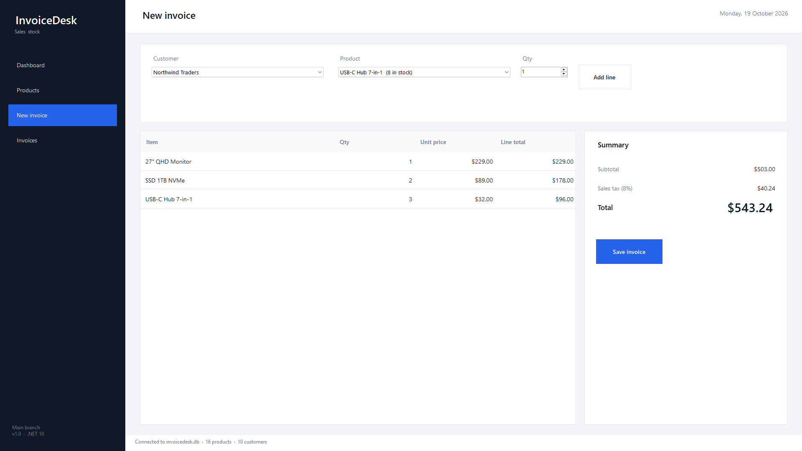
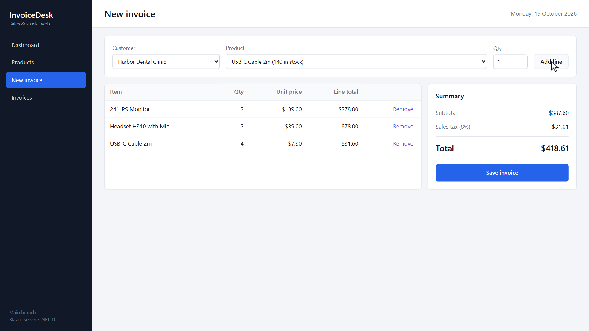
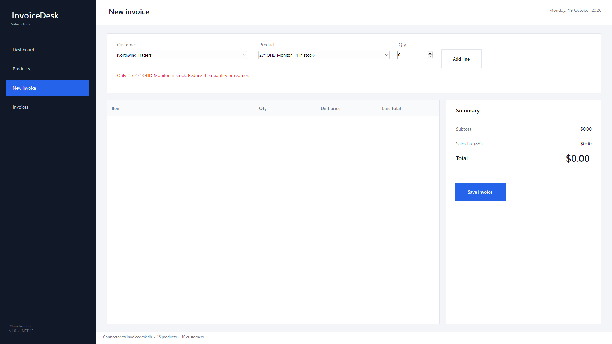
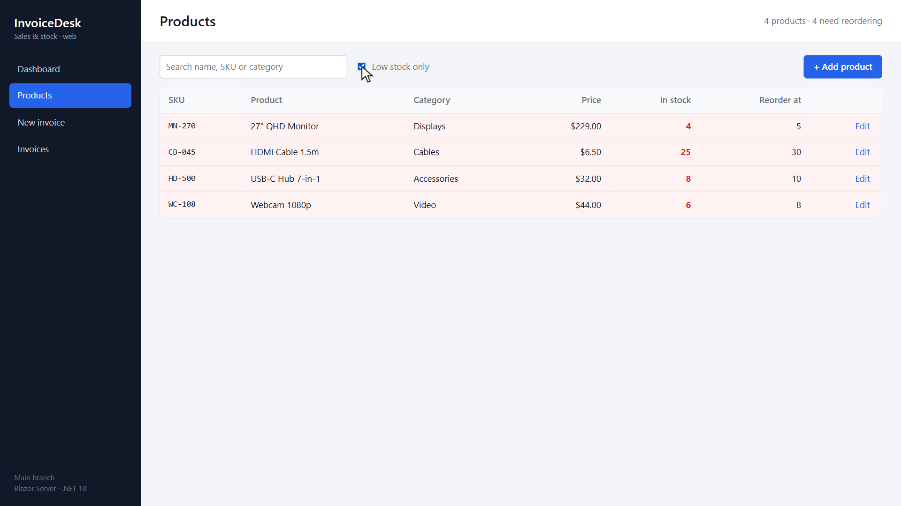
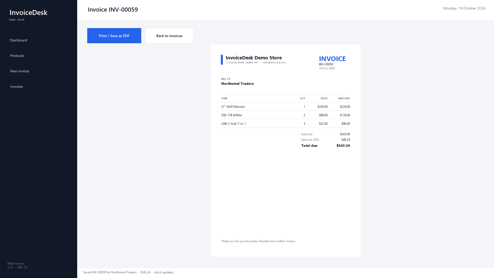
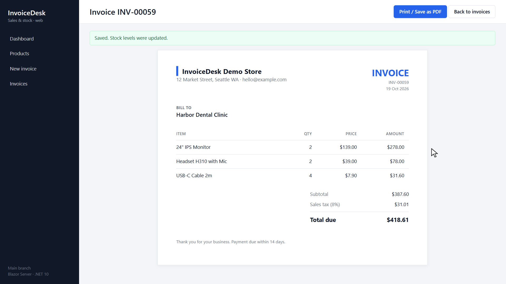

# InvoiceDesk: one C# core, a WinForms desktop app and a Blazor web app

A small sales and stock system for a shop: products with reorder levels, customers,
invoices with sales tax, a dashboard and CSV export. The interesting part is the structure.
The business rules live in one class library and are used by **both** a Windows
desktop app (WinForms) and a web app (Blazor Server), so the two can never disagree about
stock or totals.

Built on **.NET 10**, with SQLite and plain ADO.NET. Tests use xUnit.

| Desktop (WinForms) | Web (Blazor Server) |
|---|---|
|  |  |
|  |  |

## What it does

- **Dashboard**: revenue this month, invoice count, low-stock alerts and a 14-day revenue chart
- **Products**: search by name, SKU or category. Items at or below their reorder level are highlighted. Add and edit with validation.
- **New invoice**: pick a customer and products. Over-selling is blocked before saving (*"Only 4 x 27" QHD Monitor in stock"*).
- **Saving** writes the invoice and takes the items out of stock in **one transaction**
- **Printable invoice**: the desktop app uses `PrintDocument`/print preview, and the web app uses a print stylesheet (Save as PDF works)
- **CSV export** of the filtered invoice list, with proper quoting

## Projects

```
src/InvoiceDesk.Core      models, SQLite store, business rules, seed data
src/InvoiceDesk.Desktop   WinForms UI (net10.0-windows)
src/InvoiceDesk.Web       Blazor Server UI, interactive server render mode
tests/InvoiceDesk.Tests   xUnit tests for the core rules
```

## Run it

```sh
# desktop (Windows)
dotnet run --project src/InvoiceDesk.Desktop

# web
dotnet run --project src/InvoiceDesk.Web      # then open http://localhost:5290

# tests
dotnet test
```

On first start, each app creates its own SQLite database with demo data: 16 products,
10 customers and about 40 days of invoices.

```
Passed!  - Failed: 0, Passed: 8, Skipped: 0, Total: 8 - InvoiceDesk.Tests.dll (net10.0)
```

## Design notes

- `InvoiceStore` is the only class that touches the database. Both UIs call the same
  methods, such as `SaveInvoice`, `GetDashboard` and `ToCsv`.
- Stock is checked twice. The UI checks it while lines are added, so the user gets fast feedback.
  `SaveInvoice` checks it again inside the transaction, so two users can't both sell the last item.
- The desktop app builds its UI in code and has no designer files, so diffs stay readable.
  Text and layout scale with `Theme.Scale`.
- The desktop app has a `--record` mode that plays a scripted walkthrough and records it to
  video. The app renders its own frames, so nothing on the screen gets captured.

## More screenshots

| | |
|---|---|
|  |  |
|  |  |

## About

Written by Ahsan (Code Projects on YouTube). I build C# desktop and Blazor web apps, and I
modernise older .NET projects. Issues and pull requests are welcome.

Licensed under the MIT License.
